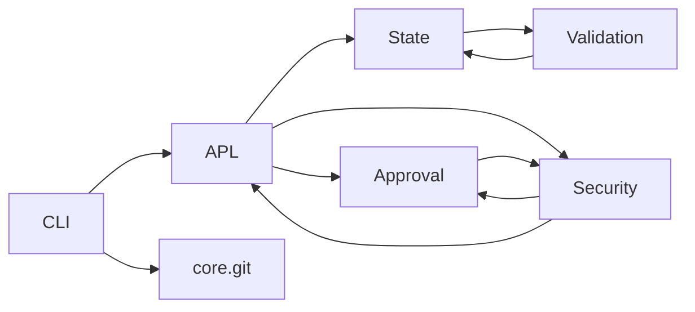

# Inventário arquitetural M0

Referência normativa: [ADR 0017](decisions/0017-architecture-m0-baseline.md).
Snapshot de 2026-11-20 sobre o working tree, incluindo as entregas não commitadas
das ADRs 0011–0016. Não é análise apenas do HEAD. Fingerprint e proveniência
ficam em `tests/architecture_baseline.json`; são informativos, não congelam fontes.

## Mapa estático atual

Inventário de 102 módulos Python: 1861 bindings de import de runtime, dos quais
222 dentro de funções, e um binding exclusivo de TYPE_CHECKING. Contagens são
bindings (cada símbolo de um from-import conta), não instruções import ou efeitos
de execução. O baseline contém 29 chaves de dívida; zero importações dinâmicas
identificadas com alvo não resolvido. Duplicatas por regra/módulo/alvo são agregadas.

Os três pares bidirecionais representam dois componentes fortemente conexos:
`{apl, approval, security}` e `{state, validation}`. Não são três problemas isolados.
Retirar uma aresta de um par não necessariamente desfaz o grupo maior.



O diagrama é um recorte do estado atual, não o alvo. Arestas são imports
declarados entre componentes; não representam chamadas ou prova de inicialização.

| Origem | Destinos internos de primeiro nível (runtime, inclusive imports tardios) |
| --- | --- |
| agents | planning |
| apl | agents, approval, planning, runtime, security, state, validation |
| approval | security |
| cli | agents, apl, approval, codex_skill, config, core, environment, execution_selection, git, init, planning, runtime, security, state, validation |
| config | agents |
| core | git, state |
| delivery | planning, state, validation |
| environment | config |
| execution_selection | config |
| init | config |
| recovery | approval, teg |
| runtime | agents |
| security | apl, approval |
| state | agents, git, planning, runtime, validation |
| teg | approval |
| validation | git, planning, state |
| __main__ | cli |

Contratos já designados puros: `apl.contracts`, `approval.contracts`,
`approval.protocol`, `agents.contracts`, `agents.selection`, `git.contracts`,
`state.contracts`, `validation.contracts`, `teg.contracts`, `planning.models`.
`agents.selection → planning.loader` ainda é dívida: usa helpers de serialização
reexportados pela fachada planning. Extrair helpers exige preservar sua semântica.
`teg.contracts → approval.protocol` é dependência entre DTOs, não implementação.

## Pontos de dívida e sua saída

| Ponto | Evidência atual | Fatia de correção |
| --- | --- | --- |
| Fachadas eager | security.__init__ importa authoritative_consent; approval.__init__ importa webauthn; apl/state/validation reexportam implementações | M1: imports locais não carregam a pilha avançada; compatibilidade não exige carregar tudo no startup. |
| apl/security/approval | authorized_execution importa LocalGrant/perfil; consentimento importa serviços APL; BrokerStore importa DTOs/helpers de security | M2: contratos inferiores e dependências unidirecionais. |
| state/validation | state.validation importa validation.contracts; scheduler importa erros de state.contracts | M2: protocolo de store e erros de domínio sem import reverso. O store em TYPE_CHECKING não é edge de runtime. |
| Agente concreto em APL | codex_planner importa CodexAdapter em uma função | M1/M3: criação nas bordas; alias de compatibilidade não deve reintroduzir dependência. |
| Store concreto em core | core.git importa GitStateStore para coordenação/anotação | M2/M3: protocolo do repositório, preservando serviço público existente. |
| Monólitos | approval/persistence: 2750 linhas; apl/authorized_execution: 2295; cli: 1150 nesta captura | M3: extrações por agregado/fluxo, sem dividir transações. LOC é sinal, não critério de qualidade isolado. |
| Planejamento | initial_planning: 787 linhas; diálogo plan_read/plan_index em codex_planner: 267; master_plan: 198 | M3: separar discovery, contratos de leitura, validação, materialização/publicação, preservando digest e recuperação. |

Uma verificação manual em subprocesso novo, com import hook bloqueando
`cryptography`, confirmou falha em `import agentflow.cli`:

```text
cli: SecurityProfile
  -> security.__init__
  -> security.authoritative_consent
  -> approval.__init__
  -> approval.webauthn
  -> cryptography.exceptions
```

Isso registra falha conhecida, não um teste que deva exigir a falha para sempre.
A prova positiva sem cryptography é saída de M1. Trocar só para import de
submódulo não basta, pois os inicializadores de pacotes continuam executando.

## Inventário de compatibilidade

| Fronteira | O que não pode mudar numa extração mecânica | Evidência existente a preservar |
| --- | --- | --- |
| CLI pública | Entry point, flags, aliases inativos, JSON, stderr, exit codes, paths, idempotência e retomada | foundation, local_entrypoint, codex_skill_integration, apl, invoker_agent_selection |
| Configuração/agentes | v1/v2, none legado, precedência do chamador, perfis opcionais e modo cli-default | foundation, invoker_agent_selection, native_cli_default_selection, suites dos adaptadores |
| Planejamento | Arquivos manuais preservados, fila milestone/work, goals/acceptance, DAG e digests | planning, apl_initial_planning, task_queue |
| Plano progressivo | SHA, linhas/seções, paginação, orçamento de contexto sem teto do arquivo, workspace sintético | master_plan_context, apl_codex_planner |
| Execução/IFR | Binding de plano/executor/versão, quotas, fencing, cancelamento, unknown e ausência de replay ambíguo | apl_authorized_execution, apl_failure_recovery, state/recovery e CLI |
| Handoff/aceite | Outcomes legados, deps diretas, sem truncamento artificial, gates independentes | handoff, apl_codex_execution e validação F5 |
| Persistência/auditoria | Schemas, FKs, backup/recovery, append-only, conexão/transação, payloads canônicos, assinaturas e hashes | state_*, approval/authorization, phase7 e teg |
| Runtime | Stdin em thread, stdout/stderr drenados, timeout/idle distintos, encerramento de árvore e identidade de processo | local_runtime, runtime_stdin_progress, runtime de validação |
| Distribuição | Wheel instalado fora do checkout, entrypoint e package data, instalação editável | Guard da CI existente e suites executadas contra pacote instalado |

Os nomes acima indicam famílias em `tests/`, não uma seleção exaustiva ou
substituto para a suíte completa. Hooks/monkeypatches sobre globals de cli são
acoplamentos de teste a considerar na extração; preservar a API pública não
significa congelar indefinidamente todos esses detalhes internos.

## Layout local e retenção — inventário, sem cleanup novo

| Artefato | Papel | Política nesta etapa |
| --- | --- | --- |
| config.toml; spec.toml; tasks.toml | Preferências e definições | Preservar; não sobrescrever no init. Só os dois TOMLs de definição são versionados por contrato atual. |
| state.sqlite3, WAL/SHM, backups | Estado operacional e recuperação | Não copiar somente o arquivo principal em WAL nem remover por idade. |
| executor-selections/ | Seleção vinculada ao contrato por digest | Essencial à retomada/auditoria; não tratar como log descartável. |
| objective-runs/, objective-plans/ | Manifests e planos exatos das execuções | Preservar referências/digests; não limpar se necessários a job ou histórico. |
| runs/*/metadata.json, stdout/stderr | Diagnóstico e evidência de processo | Retenção própria após término; preservar vínculos/digests exigidos pela auditoria. |
| acceptance-evidence/, snapshots/, artifacts/ | Verificações, snapshots e entregas | Preservar enquanto referenciados; política de descarte requer inventário explícito. |
| cancel.flag e temporários | Controle/transição local | Nunca confundir presença/ausência com prova de ausência de efeito. |

O layout ainda é distribuído entre contratos e implementação. Sua consolidação
e cleanup com dry-run ficam para fatia própria; M0 não apaga nada.

## Como validar e reduzir

```text
.venv/Scripts/python.exe -m pytest -q tests/test_architecture_boundary.py
.venv/Scripts/python.exe -m pytest -q
```

Em Linux, use o Python do ambiente correspondente. O teste usa o pacote ativo,
inclusive wheel instalado, e baseline ao lado dos testes. O helper AST não abre
bancos nem importa subpacotes AgentFlow, e não precisa de dependências de lint.

Quando corrigir uma dívida, remova apenas suas chaves obsoletas do baseline.
O teste lista violações novas e exceções que devem sair. Não copie um relatório
novo sobre o baseline para aceitar regressão. Atualize inventário/ADR conforme
a mudança autorizada; contagens e fingerprint acima são o snapshot M0, não metas
imutáveis para o produto.
